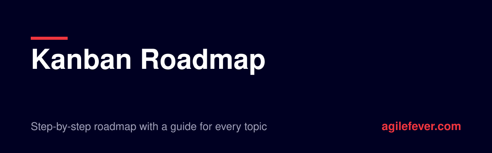

# Kanban Roadmap

> Kanban Roadmap - A step-by-step roadmap to learn Kanban and flow metrics, and to move through the Kanban University certification path, with a blog for every topic

## Table of Contents

- [Who is a Kanban Practitioner?](#who-is-a-kanban-practitioner)
- [The Kanban Certification Path](#the-kanban-certification-path)
- [How to Use This Roadmap](#how-to-use-this-roadmap)
- [Step 0: Must Know](#step-0-must-know)
- [Step 1: Kanban Principles and Practices](#step-1-kanban-principles-and-practices)
- [Step 2: The Kanban Board and Cards](#step-2-the-kanban-board-and-cards)
- [Step 3: Pull Systems and WIP Limits](#step-3-pull-systems-and-wip-limits)
- [Step 4: Flow Metrics](#step-4-flow-metrics)
- [Step 5: Kanban Cadences and Meetings](#step-5-kanban-cadences-and-meetings)
- [Step 6: Kanban in Your Kind of Work](#step-6-kanban-in-your-kind-of-work)
- [Step 7: Kanban with Scrum, SAFe, and Tools](#step-7-kanban-with-scrum-safe-and-tools)
- [Step 8: Team Kanban Practitioner (TKP)](#step-8-team-kanban-practitioner-tkp)
- [Step 9: Kanban System Design (KSD)](#step-9-kanban-system-design-ksd)
- [Step 10: Kanban Systems Improvement (KSI)](#step-10-kanban-systems-improvement-ksi)
- [Step 11: Kanban Management Professional (KMP)](#step-11-kanban-management-professional-kmp)
- [Step 12: Flow Manager](#step-12-flow-manager)
- [Step 13: Kanban Coaching Professional (KCP) and Next Steps](#step-13-kanban-coaching-professional-kcp-and-next-steps)
- [Learn This Roadmap with a Mentor](#learn-this-roadmap-with-a-mentor)
- [License](#license)

### Prepared and maintained by [AgileFever](https://agilefever.com)

### Follow AgileFever

- [LinkedIn](https://www.linkedin.com/company/agilefever/)
- [YouTube](https://www.youtube.com/@AgileFever)
- [X](https://x.com/agilefever)
- [Website](https://agilefever.com)

## Learn with AgileFever

- [Team Kanban Practitioner (TKP)](https://agilefever.com/kanban/team-kanban-practitioner-training-tkp/)
- [Kanban System Design (KSD)](https://agilefever.com/kanban/kanban-system-design-training/)
- [Kanban Systems Improvement (KSI)](https://agilefever.com/kanban/kanban-systems-improvement/)
- [Kanban Management Professional (KMP I and II)](https://agilefever.com/kanban/kanban-management-professional-training-kmp1-kmp2/)
- [Flow Manager](https://agilefever.com/kanban/flow-manager-certification-training/)
- [Kanban Coaching Professional (KCP)](https://agilefever.com/kanban/kanban-coaching-professionals-certification-kcp/)

---

> **Note: We will keep updating this roadmap with new topics and blogs.**

---

### Who is a Kanban Practitioner?

A Kanban practitioner is someone who uses the Kanban Method to make work visible, limit how much is in progress, and improve how work flows to the customer. The method works for software teams, but also for support, HR, marketing, operations, and manufacturing.

In simple words, a Kanban practitioner:

- **Makes work visible:** puts every piece of work on a board, with clear columns and policies.
- **Limits work in progress:** stops starting new things until old ones finish, so work moves faster.
- **Manages flow with data:** uses lead time, cycle time, throughput, and work in progress to see what is really happening and to make promises the team can keep.
- **Improves step by step:** changes the system in small experiments instead of a big reorganization.

Kanban University defines the Kanban Method and the certifications. AgileFever teaches the courses. This roadmap first builds the concepts and flow metrics, then follows the certification path from the team level to coaching.

### The Kanban Certification Path

Each course builds on the one before it. Take them in this order.

| Course | Who it is for | What it covers |
| --- | --- | --- |
| [Team Kanban Practitioner (TKP)](https://agilefever.com/kanban/team-kanban-practitioner-training-tkp/) | Team members new to Kanban | The six practices, Kanban events, metrics, classes of service |
| [Kanban System Design (KSD)](https://agilefever.com/kanban/kanban-system-design-training/) | People who set up Kanban for a team or service | Principles, STATIK, board and ticket design |
| [Kanban Systems Improvement (KSI)](https://agilefever.com/kanban/kanban-systems-improvement/) | People who improve and scale Kanban | Maturity model, feedback loops, enterprise Kanban, bottlenecks |
| [Kanban Management Professional (KMP I and II)](https://agilefever.com/kanban/kanban-management-professional-training-kmp1-kmp2/) | Managers and leads | KSD and KSI together as one program |
| [Flow Manager](https://agilefever.com/kanban/flow-manager-certification-training/) | People who manage service delivery and flow | Flow management principles, workflow analysis, predictability and scaling |
| [Kanban Coaching Professional (KCP)](https://agilefever.com/kanban/kanban-coaching-professionals-certification-kcp/) | Coaches and change agents | Kanban Maturity Model and the coaching of evolutionary change |

### How to Use This Roadmap

This roadmap is designed so that anyone can follow it in the given order, even without any prior Kanban experience.

- Follow the steps in order. Each step builds on top of the previous one.
- Steps 0 to 7 are the concepts, the flow metrics, and Kanban in practice. Steps 8 to 13 are the certifications.
- Inside each step, read the blogs in the given order. Every blog explains one idea in plain words.
- After every step, try it on a real board, even a personal one. Kanban is learned by doing.
- Where a topic is listed without a link, it is a topic to look up in the course material.

Let's get started.

### Step 0: Must Know

Before going deep, we must know the words that come up in every Kanban conversation: Kanban board, work in progress (WIP), pull system, lead time, cycle time, and throughput.

- [What is Kanban and what are its core principles?](https://agilefever.com/what-is-kanban-what-are-its-core-principles/)
- [Kanban basics: a comprehensive guide](https://agilefever.com/kanban-basics-a-comprehensive-guide-to-mastering-kanban/)
- [Kanban meaning: understanding the basics and beyond](https://agilefever.com/demystifying-kanban-understanding-the-basics-and-beyond/)
- [How does Kanban work?](https://agilefever.com/how-does-kanban-work-streamlining-workflow-with-visual-management/)
- [Kanban Guide to Agile project management](https://agilefever.com/unlocking-the-kanban-meaning-a-comprehensive-guide-to-agile-project-management/)

### Step 1: Kanban Principles and Practices

The Kanban Method rests on a small set of principles and practices. Knowing the difference between the two is a common starting point in any course.

- [Kanban principles vs Kanban practices](https://agilefever.com/kanban-principles-vs-practices/)
- [4 key Kanban principles for business success](https://agilefever.com/the-4-esskanban-principles-for-achieving-business-success/)
- [Key characteristics of Kanban](https://agilefever.com/key-characteristics-of-kanban/)
- [Kanban principles for software development](https://agilefever.com/essential-kanban-principles-for-software-development-success/)
- [Kanban framework: a complete guide](https://agilefever.com/the-ultimate-guide-to-the-kanban-framework-everything-you-need-to-know/)
- [Benefits of the Kanban system](https://agilefever.com/exploring-the-benefits-of-a-kanban-system/)
- [Kanban vs Kaizen](https://agilefever.com/kanban-vs-kaizen-a-comprehensive-analysis-for-process-improvement/)

### Step 2: The Kanban Board and Cards

A board is how a team sees its work. In this step, we will learn how to build a board, what goes on a card, and how to start with a personal board.

- [Kanban board: what it is and how to use it](https://agilefever.com/what-is-kanban-board-how-to-use-it/)
- [Kanban board template: columns, WIP limits and policies](https://agilefever.com/kanban-board-template/)
- [Kanban board examples for software, marketing, HR and support](https://agilefever.com/kanban-board-examples/)
- [Kanban cards for workflow management](https://agilefever.com/what-are-kanban-cards/)
- [Personal Kanban: set up your own board in 15 minutes](https://agilefever.com/personal-kanban/)
- [Class of service and work item type](https://agilefever.com/one-class-of-service-and-work-item-type-in-kanban-agilefever/)
- [Two-bin Kanban system](https://agilefever.com/what-is-a-two-bin-kanban-system-how-does-it-work/)

### Step 3: Pull Systems and WIP Limits

Limiting work in progress is the practice that changes how a team behaves. A pull system means a new item starts only when there is capacity to take it.

- [Kanban pull system: everything you need to know](https://agilefever.com/what-is-kanban-pull-system-things-to-know/)
- [How to set WIP limits: a method with worked examples](https://agilefever.com/how-to-set-wip-limits/)
- [Boosting software workflow with a Kanban pull system](https://agilefever.com/unleashing-the-potential-of-the-kanban-pull-system-supercharging-software-throughput/)
- [Little's Law](https://agilefever.com/littles-law/)
- [Kanban backlog management](https://agilefever.com/the-hidden-power-of-kanban-backlog-management-for-maximum-efficiency/)
- [Kanban flow: effective task management](https://agilefever.com/mastering-kanban-flow-boosting-productivity-and-efficiency-with-effective-task-management/)

### Step 4: Flow Metrics

Flow metrics tell us how work really moves. They let a team forecast, find delays, and talk about delivery with numbers instead of opinions. These four measures are the core: lead time, cycle time, throughput, and work in progress.

- [Kanban metrics: what they are and which to track](https://agilefever.com/what-are-kanban-metrics-how-to-track-them/)
- [Kanban metrics: key flow metrics](https://agilefever.com/kanban-metrics-key-flow-metrics-agilefever/)
- [Lead time: definition and why it matters](https://agilefever.com/demystifying-lead-time-definition-understanding-the-essence-and-importance/)
- [Lead time: meaning, key insights and definitions](https://agilefever.com/understanding-the-lead-time-meaning-key-insights-and-definitions/)
- [Kanban cycle time: a complete guide](https://agilefever.com/the-ultimate-guide-to-understanding-kanban-cycle-time/)
- [What is flow time?](https://agilefever.com/what-is-flow-time/)
- [Kanban velocity does not exist: track throughput instead](https://agilefever.com/kanban-velocity-vs-throughput/)
- [Increasing Kanban throughput](https://agilefever.com/increasing-kanban-throughput-strategies-for-optimizing-workflow-and-productivity/)
- [How to read a cumulative flow diagram in 10 minutes](https://agilefever.com/cumulative-flow-diagram/)
- [Kanban reports: CFD, control chart and cycle time scatterplot](https://agilefever.com/kanban-reports/)
- [Kanban reporting for business productivity](https://agilefever.com/unlocking-business-productivity-with-kanban-reporting-a-comprehensive-guide/)
- [Kanban metrics training for managers: reading flow data without micromanaging](https://agilefever.com/kanban-metrics-training-for-managers/)

### Step 5: Kanban Cadences and Meetings

Kanban has feedback loops, called cadences, that keep the system honest. They include the daily standup, replenishment, delivery planning, and review and retrospective.

- [Kanban cadences: optimizing Agile workflows](https://agilefever.com/optimizing-agile-workflows-with-effective-kanban-cadences/)
- [Kanban ceremonies](https://agilefever.com/unveiling-the-power-of-kanban-ceremonies-boost-your-team-s-productivity/)
- [Essential elements of Kanban meetings](https://agilefever.com/essential-elements-of-kanban-meetings-enhancing-task-efficiency-and-team-productivity/)
- [Kanban retro: 7 tips to try](https://agilefever.com/7-kanban-retro-tips-you-need-to-try/)
- [Kanban planning](https://agilefever.com/mastering-kanban-planning-a-comprehensive-guide/)
- [Kanban roles: a complete guide](https://agilefever.com/exploring-the-essential-kanban-roles-a-comprehensive-guide/)

### Step 6: Kanban in Your Kind of Work

Kanban is not only for software. Here we look at how the same ideas fit testing, support, marketing, HR, operations, and manufacturing.

- [Kanban practices for software development](https://agilefever.com/kanban-practices-for-software-development/)
- [Kanban for software testing teams](https://agilefever.com/kanban-for-software-testing-teams/)
- [Kanban for IT operations and support teams](https://agilefever.com/kanban-for-infrastructure-operations-support-service-team-processes/)
- [Kanban for marketing teams](https://agilefever.com/kanban-for-marketing-teams/)
- [Kanban for HR and recruiting teams](https://agilefever.com/kanban-for-hr-and-recruiting-teams/)
- [Kanban for manufacturing](https://agilefever.com/implementing-kanban-in-manufacturing-the-ultimate-guide-for-streamlining-operations/)
- [Kanban in lean manufacturing](https://agilefever.com/unleashing-efficiency-and-agility-exploring-the-kanban-system-in-lean-manufacturing/)
- [Kanban for project management](https://agilefever.com/kanban-for-project-management-streamlining-workflows-for-success/)

### Step 7: Kanban with Scrum, SAFe, and Tools

Most teams meet Kanban next to something else. This step covers when to choose Kanban or Scrum, how to mix them, and which tools to set up.

- [Kanban vs Scrum: which is right for your team?](https://agilefever.com/kanban-vs-scrum-which-is-best-for-you/)
- [How to choose between Scrum and Kanban](https://agilefever.com/how-to-choose-between-scrum-and-kanban-for-your-teams/)
- [Scrumban and its potential](https://agilefever.com/scrumban-and-its-potential-for-boosting-agile-productivity/)
- [Scrum Better With Kanban (SBK)](https://agilefever.com/scrum-better-with-kanban-sbk/)
- [How Kanban is used in SAFe](https://agilefever.com/ways-kanban-is-used-in-safe-a-powerful-agile-tool-for-effective-workflow-management/)
- [How to create a Kanban board in Jira](https://agilefever.com/how-to-create-a-kanban-board-in-atlassian-jira/)
- [How Jira dashboards help Kanban teams](https://agilefever.com/jira-for-kanban-teams/)
- [Top 10 free online Kanban tools](https://agilefever.com/top-10-free-online-kanban-tools-for-efficient-project-management/)

### Step 8: Team Kanban Practitioner (TKP)

TKP is the first certification. It is a short course with a Kanban simulation, the six practices in a team setting, Kanban events, metrics, and classes of service. [Course page](https://agilefever.com/kanban/team-kanban-practitioner-training-tkp/).

- [Team Kanban Practitioner certification: mastering Agile workflow management](https://agilefever.com/team-kanban-practitioner-certification-mastering-agile-workflow-management/)
- [Exploring the Team Kanban Practitioner certification](https://agilefever.com/navigating-collaboration-and-efficiency-exploring-team-kanban-practitioner-certification/)
- [TKP certification: salary and job insights](https://agilefever.com/tkp-certification-salary-job-and-salary-scope-in-2023/)
- [Kanban certification: everything you need to know](https://agilefever.com/kanban-certification-everything-you-need-to-know/)
- [Different types of Kanban certifications](https://agilefever.com/different-types-of-kanban-certifications-a-complete-guide/)

### Step 9: Kanban System Design (KSD)

KSD teaches you to design a Kanban system for a real service. You play a flow simulation, learn the principles and practices, apply STATIK (Systems Thinking Approach to Introducing Kanban), and design your own board and tickets. [Course page](https://agilefever.com/kanban/kanban-system-design-training/).

- [Kanban system design: a complete guide](https://agilefever.com/kanban-system-design-everything-you-need-to-know/)
- [10 important things to consider about Kanban system design](https://agilefever.com/10-important-things-to-consider-about-kanban-system-design/)
- [STATIK: a systems thinking approach to introducing Kanban](https://agilefever.com/what-is-statik-systems-thinking-approach-to-introducing-kanban/)
- [STATIK step by step: a worked example for a support team](https://agilefever.com/statik-worked-example/)
- [How to implement Kanban system design](https://agilefever.com/how-to-implement-kanban-system-design/)
- [Principles of Kanban system design: visualizing workflow](https://agilefever.com/the-principles-of-kanban-system-design-visualizing-workflow-and-managing-the-flow/)
- [How to get certified in Kanban system design](https://agilefever.com/how-to-get-certified-in-kanban-system-design/)
- [Benefits of Kanban system design certification](https://agilefever.com/the-benefits-of-kanban-system-design-certification/)

### Step 10: Kanban Systems Improvement (KSI)

KSI is about improving a system that already exists. It covers Kanban as an evolutionary change method, the Kanban Maturity Model (ML0 to ML4), feedback loops, demand patterns, dependencies, and bottlenecks. [Course page](https://agilefever.com/kanban/kanban-systems-improvement/).

- [Kanban system improvement certification](https://agilefever.com/kanban-system-improvement-certification-enhancing-agility-and-efficiency/)
- [Kanban Maturity Model: a step-by-step approach](https://agilefever.com/the-ultimate-guide-to-kanban-maturity-model-a-step-by-step-approach/)
- [Evolutionary management: 10 strategies](https://agilefever.com/10-powerful-strategies-for-implementing-evolutionary-management-in-your-organization/)
- [Kanban rollout plan across departments: 90 days](https://agilefever.com/kanban-rollout-plan/)
- [Kanban implementation: implementing a Kanban system the right way](https://agilefever.com/kanban-implementation-implement-a-kanban-system-the-right-way/)
- [The Maturity Effect](https://agilefever.com/the-maturity-effect-uncovering-the-impact-and-benefits-of-this-phenomenon/)
- [Kanban for Design and Innovation (KDI)](https://agilefever.com/kanban-for-design-and-innovation-kdi/)
- Bottlenecks and the theory of constraints

### Step 11: Kanban Management Professional (KMP)

KMP combines KSD and KSI into one program, and holding the KMP credential is also a requirement for the coaching track. [Course page](https://agilefever.com/kanban/kanban-management-professional-training-kmp1-kmp2/).

- [Kanban Management Professional (KMP) certification](https://agilefever.com/success-with-kanban-management-professional-certification-kmp/)
- [Mastering Kanban system design: achieve KMP 1](https://agilefever.com/kmp-1-certification-with-agilefever/)
- [Compare TKP, KMP, KMP1 and KMP2](https://agilefever.com/best-kanban-certification-tkp-vs-kmp-vs-kmp1-vs-kmp2/)
- [KMP certification: salary and job insights](https://agilefever.com/kmp-certification-salary-job-and-salary-scope-in-2023/)
- [Top Kanban University certifications](https://agilefever.com/top-ku-kanban-certification-find-the-best-one-for-you/)
- [Benefits of Kanban University](https://agilefever.com/discover-the-benefits-and-best-practices-of-kanban-university/)

### Step 12: Flow Manager

The Flow Manager course is for people who manage service delivery. It covers flow management principles, improving service delivery, analyzing workflow, and enabling predictability and scaling. It relies on the flow metrics from Step 4. [Course page](https://agilefever.com/kanban/flow-manager-certification-training/).

- [Kanban metrics training for managers](https://agilefever.com/kanban-metrics-training-for-managers/)
- [Who is responsible for the portfolio Kanban?](https://agilefever.com/who-is-responsible-for-managing-the-portfolio-kanban/)
- [Corporate Kanban training: which teams to train first](https://agilefever.com/corporate-kanban-training/)
- [Kanban for IT operations and support: a training plan for the whole service desk](https://agilefever.com/kanban-training-for-it-operations/)
- [Scaling Kanban across the enterprise](https://agilefever.com/kanban-rollout-plan/)
- Predictability and forecasting with flow data

### Step 13: Kanban Coaching Professional (KCP) and Next Steps

KCP is the top of the path. It combines the Kanban Maturity Model course with the Kanban Coaching course, and covers the psychology and sociology of change and how to coach evolutionary change. The KMP credential is a requirement. [Course page](https://agilefever.com/kanban/kanban-coaching-professionals-certification-kcp/).

- [Become a certified Kanban Coaching Professional](https://agilefever.com/elevate-your-agility-becoming-a-certified-kanban-coaching-professional/)
- [Principles of change management](https://agilefever.com/mastering-the-principles-of-change-management-for-streamlined-success/)
- [Change leadership training](https://agilefever.com/master-the-art-of-change-leadership-training-a-guide-to-effective-transformation/)
- [The most valuable Kanban certification for you](https://agilefever.com/the-most-valuable-kanban-certification-course-for-you-2023/)
- [The 10 greatest benefits of Kanban certification](https://agilefever.com/the-10-greatest-benefits-of-kanban-certification-in-2023/)
- [Top 31 Kanban FAQs](https://agilefever.com/top-kanban-faqs-that-can-boost-your-career/)
- [Corporate Kanban and SAFe training: choosing the framework](https://agilefever.com/corporate-kanban-and-safe-training-choosing-the-framework/)

### Learn This Roadmap with a Mentor

If you want to learn this roadmap with a live instructor, AgileFever teaches the full Kanban University path. Start with [Team Kanban Practitioner](https://agilefever.com/kanban/team-kanban-practitioner-training-tkp/) and move on to [Kanban System Design](https://agilefever.com/kanban/kanban-system-design-training/) and [Kanban Systems Improvement](https://agilefever.com/kanban/kanban-systems-improvement/), or take them together as [KMP](https://agilefever.com/kanban/kanban-management-professional-training-kmp1-kmp2/).

### License

This roadmap is licensed under CC BY 4.0. You may share and adapt it with credit to AgileFever.
